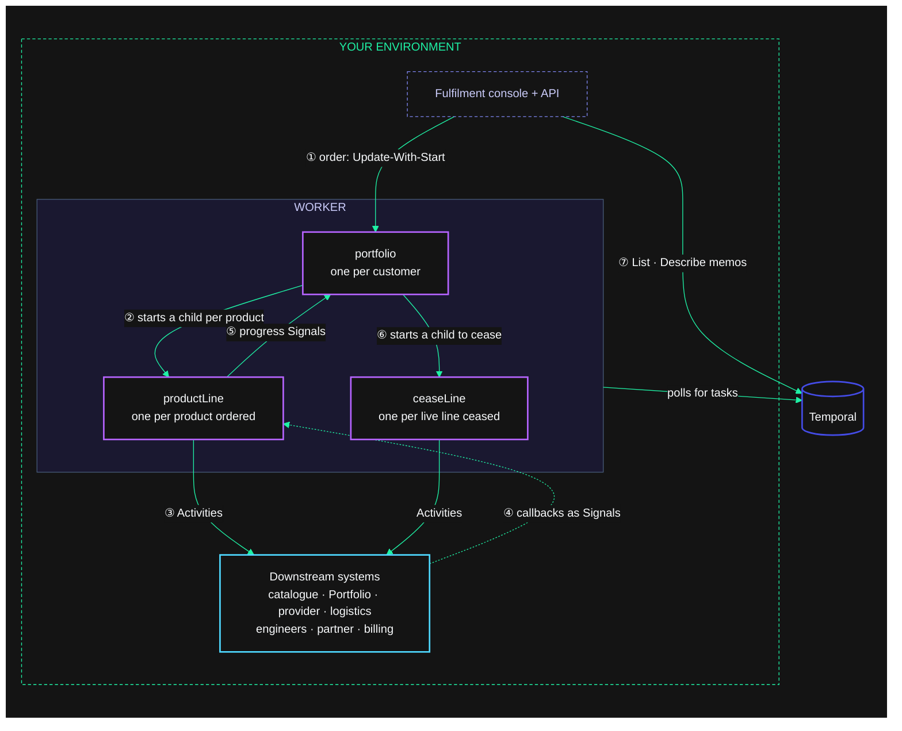

# Broadband fulfilment at the portfolio level

A fulfilment console built on Temporal. Each customer's portfolio takes every order. Each product line follows a route from the product catalogue. A second order (an upgrade before activation, a cancellation of one product) changes the steps of lines still in flight, while downstream systems fail and recover around it.

What's in it:

- A **portfolio** [Workflow](https://docs.temporal.io/workflows) per customer, started and sent orders with [Update-With-Start](https://docs.temporal.io/develop/typescript/message-passing#update-with-start). Its Update validator refuses an order that conflicts with what the customer holds.
- A **product line** [Child Workflow](https://docs.temporal.io/develop/typescript/child-workflows) per product. It runs its route stage by stage, with parallel steps and gates that wait for external events ([Signals](https://docs.temporal.io/develop/typescript/message-passing#signals)). It undoes completed steps when cancelled, starts billing only at activation, and completes there: it runs for days or weeks, not for as long as the customer keeps the product.
- A **cease** Child Workflow per live line that goes away, started by the portfolio when the customer ceases it or its upgrade goes live. It stops billing and undoes the line's steps from the plan the line handed over when it activated.
- **Routes as configuration**: versioned in a simulated product catalogue and edited on the console's Product routes page. A line loads its route once, so it stays on that version. A [Workflow Update](https://docs.temporal.io/develop/typescript/message-passing#updates) moves a running line to another version at its next gate, with or without compensation.
- The **PreActive Upgrade** scenario: REVERT (AP -> PAX -> CN) or PROVIDE (one migrate order), and the race with activation in both directions.
- [Activity retries](https://docs.temporal.io/encyclopedia/retry-policies) for seven simulated downstream systems, shown live in the console.
- A console that reads state from each Workflow's small memo through Describe and List, so it keeps working while the Worker is down. Each Workflow's history comes from a `history` [Query](https://docs.temporal.io/develop/typescript/message-passing#queries) that the API sends only when the memo says something changed.

## How it works



1. Every customer change is an order on the portfolio, sent with Update-With-Start. Its validator refuses an order that conflicts with what the customer holds.
2. The portfolio starts a `productLine` per product.
3. A line runs its route's steps as Activities against the downstream systems.
4. Downstream callbacks arrive as Signals (the console's buttons stand in for them).
5. Lines report every change to the portfolio, so the portfolio decides what happens to a live line.
6. To cease a live line, the portfolio starts a `ceaseLine`.
7. The console reads memos with List and Describe, which need no Worker.

In the PreActive Upgrade scenario, a REVERT undoes the old line (AP -> PAX -> CN) before the upgrade goes to the provider. A PROVIDE logs a CROSSGRADE cease on the old row (it stays AP) and the upgrade sends one `MIGRATE_DATA_MIGRATE_VOICE` order. If the old line activated first, it keeps billing until the upgrade activates, then the portfolio ceases it.

[docs/how-it-works.md](docs/how-it-works.md) has four more diagrams: the three Workflows' lifetimes, how a line runs its route, the activation race, and what the console reads.

| Part | Where | What it does |
|---|---|---|
| Workflows | `fulfilment/src/workflows.ts` | `portfolio` (orders, validation, decisions about live lines), `productLine` (runs a route to AC or CN) and `ceaseLine` (ceases a live line) |
| Routes and types | `fulfilment/src/domain.ts` | Route shape and its checks, row states, views |
| Activities | `fulfilment/src/activities.ts` | One per downstream action: catalogue, Portfolio, provider, logistics, engineering, partner, billing |
| Worker | `fulfilment/src/worker.ts` | Runs both, logging in logfmt |
| Console API | `fulfilment/src/api.ts` | One view endpoint and one endpoint per action |
| Console | `console/` | Customers, product lines with their routes drawn live, the Product routes editor, the Downstream systems drawer |
| Simulated systems | `downstream/` | The seven systems, each switchable to slow or failing; the seed routes |
| Tests | `fulfilment/src/workflows.test.ts` | Ten scenarios against the dev server |

## Run it

Prerequisites: Docker, Docker Compose and `make`.

```sh
make up
```

Then open the console at http://localhost:8080 and the Temporal UI at http://localhost:8233.

| Command | Does |
|---|---|
| `make up` | Builds the images and starts everything |
| `make test` | Typechecks and runs the Workflow tests in a container |
| `make crash-worker` / `make start-worker` | Kills the Worker, and brings it back |
| `make logs` | Follows the Worker and API logs |
| `make reset` | A fresh dev server and empty downstream systems |
| `make down` | Stops everything |

Presenting it, and the code behind each step: [RUNBOOK.md](RUNBOOK.md). The use case and what it answers: [docs/story.md](docs/story.md).

## Notes

- This is a private, customer-specific demo. It runs locally only, and isn't built for the demo catalog (the kit's catalog-ready baseline is waived: no per-user workspaces or hosted ingress).
- External events are buttons in the console rather than timers, so a presenter controls when each gate passes. Gate SLAs and timeouts are left out.
- Routes choose among actions fulfilment already has (an Activity each). Adding a new kind of action is a code change; changing which actions a product takes, in what order and with which gates, is not.
- The scenario document doesn't say what happens to the old row after a PROVIDE migration, or name a state for a line ceased after activation. The demo leaves the row AP with a logged CROSSGRADE cease, and uses CE for a ceased active line.
- The Workers aren't versioned. Changing Workflow code means resetting the sandbox, since running lines would replay against the new code. The design is built for [Worker Versioning](https://docs.temporal.io/worker-versioning): lines and ceases run for days or weeks and could be pinned to the version they started on, and only the portfolio, a thin loop that continues as new, lives for years.
- The history Query is the one read that needs a Worker. While the Worker is down, the console shows the last history the API fetched and says it may be out of date.
