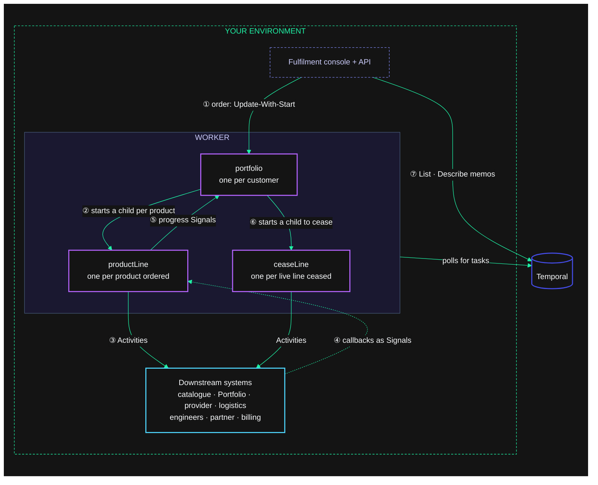
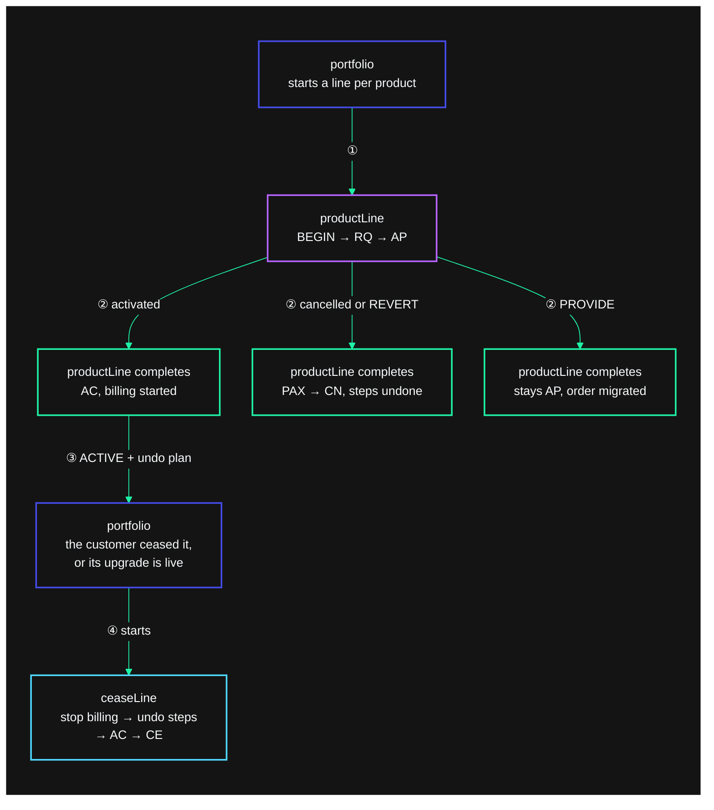
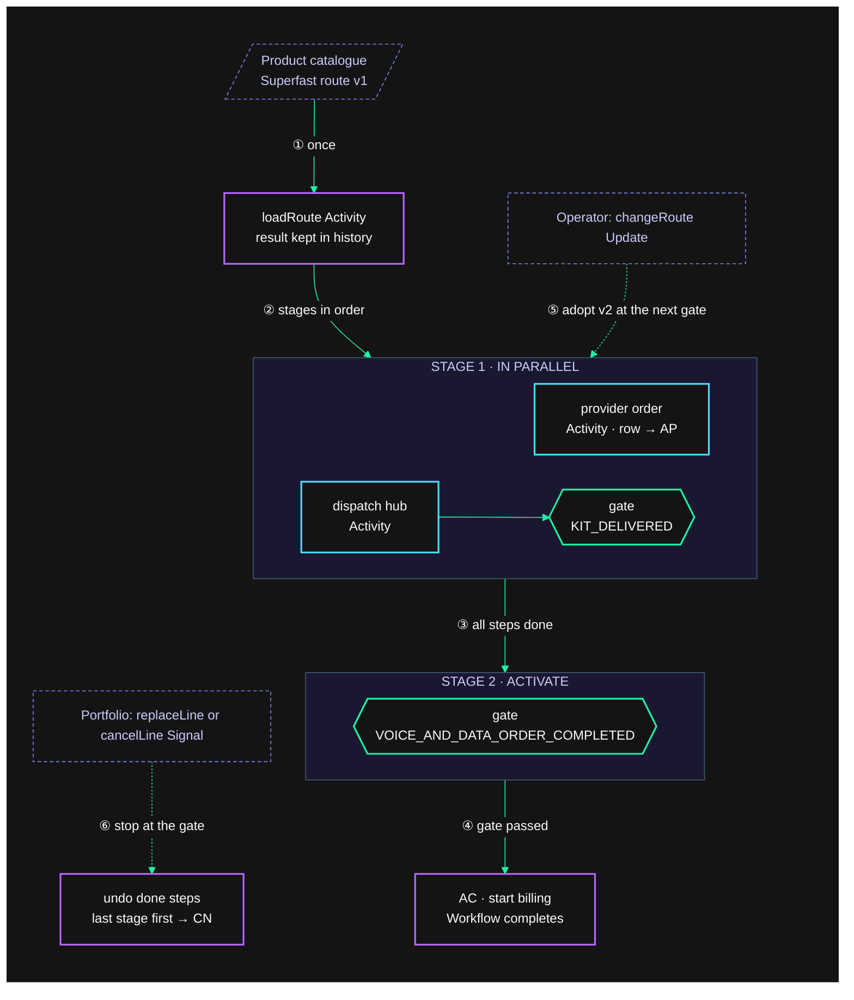
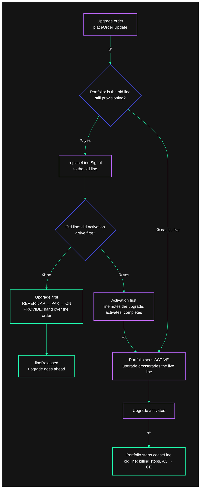
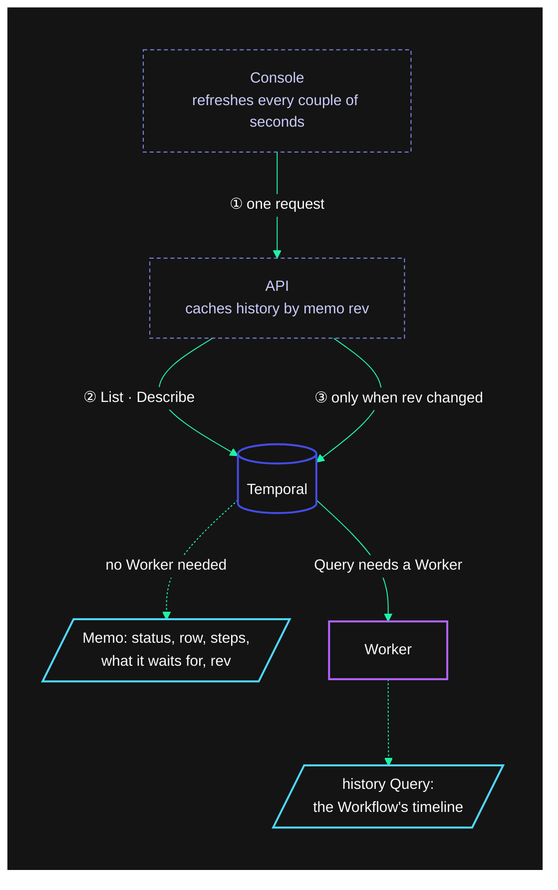

# How it works

Five diagrams, from the whole system down to a single line's route. Each has its steps written out underneath. The code references point at `fulfilment/src/workflows.ts` unless they say otherwise.

## 1. The pieces, and who calls whom

1. Every customer change is an order on the customer's portfolio, sent with Update-With-Start: it starts the portfolio for a new customer and delivers the order either way. The Update's validator refuses an order that conflicts with what the customer holds.
2. The portfolio starts one `productLine` Child Workflow per product on the order.
3. A line runs its route: each step's action is an Activity that calls a downstream system.
4. Downstream systems call back (in the demo, the console's buttons stand in for them). Each callback is a Signal to the line.
5. The line tells the portfolio about every change with a Signal, so the portfolio always knows the state of every line.
6. When a live line has to go (the customer ceased it, or its upgrade is live), the portfolio starts a `ceaseLine` Child Workflow.
7. The console reads state from the Workflows' memos with List and Describe, which the Temporal service answers without a Worker.

## 2. Three Workflows, three lifetimes

The portfolio (blue) lives as long as the customer. A `productLine` (purple) runs for days or weeks. A `ceaseLine` (cyan) runs until the provider confirms the cease.

1. The portfolio starts a line for each product ordered.
2. The line runs until provisioning has an outcome (green): active (AC), cancelled (CN), or migrated to its replacement. Then its Workflow completes.
3. On activation the line hands the portfolio an undo plan: each completed step with the reference its system returned (the provider order, the consignment, the visit).
4. When the customer ceases the live line, or its upgrade goes live, the portfolio starts a `ceaseLine` with that plan.
5. The cease stops billing, undoes the steps unless the service migrated, moves the row to CE, and reports CEASED to the portfolio.

Why three lifetimes: only the portfolio lives for years, and it's a thin loop that [continues as new](https://docs.temporal.io/develop/typescript/continue-as-new). Every other Workflow runs for days or weeks. That keeps histories short and makes the code easy to roll out with [Worker Versioning](https://docs.temporal.io/worker-versioning): a line can stay pinned to the version it started on without keeping old Workers running for years.

## 3. How a line runs its route

1. The line loads its route from the product catalogue once, with an Activity. The result is recorded in the Event History, so on replay the line gets the same route back: that's what pins it to its version.
2. Stages run in order; the steps inside a stage run in parallel (`runRoute`).
3. A step runs its action as an Activity, then waits at its gate: a `condition` on the Signals the line has received (`runStep`). An event that arrives early is kept for the step that needs it.
4. When every step is done, the line moves the row to AC, starts billing, and completes.
5. An operator can move a running line to another route version with the `changeRoute` Update. Its validator refuses a line that isn't provisioning; the switch happens at the next gate, keeping progress on shared steps and undoing (or leaving) removed ones (`adoptRoute`).
6. An upgrade or cancellation stops the line at its gate. It undoes what it did, last stage first, then the row goes to CN. With PROVIDE, it hands its provider order to the upgrade instead.

## 4. The race between activation and an upgrade

1. The upgrade is an order on the portfolio. Its validator has already refused it if the old line is being ceased or replaced.
2. If the portfolio knows the old line is live, it doesn't involve the line at all. Otherwise it Signals the old line.
3. A Workflow handles its messages one at a time, in arrival order. If the upgrade arrives first, the old line cancels (REVERT) or migrates (PROVIDE) and releases the customer's line, and a late activation is only logged. If activation arrived first, the line activates and completes.
4. The portfolio hears the line is ACTIVE and releases the upgrade to crossgrade the live service. The old line keeps billing.
5. When the upgrade activates, the portfolio starts a `ceaseLine` for the old line: billing stops, nothing is undone (the service migrated), and the row goes to CE.

Whichever way the race goes, one Workflow makes each decision, from state only it changes: the line decides whether it activated, and the portfolio decides what happens to a live line. There's no shared status to lock or compare-and-swap. The portfolio does this in `releaseIfDue` and `ceaseIfDue`.

## 5. What the console reads

1. The console makes one request per refresh, and the API makes the Temporal calls.
2. Everything the console needs to show a line moving comes from memos, read with List and Describe: status, row state, step states, the events a line waits for, billing, pending Activity retries. The Temporal service answers these without a Worker, so the console keeps updating while the Worker is down. The memo stays small. The route comes from the catalogue by version, and the history isn't in it, so a memo write doesn't copy the history into the Event History again.
3. The history (the timeline under each line) comes from the `history` Query. Each memo carries a `rev` that changes on every write, and the API sends the Query only when `rev` has moved on: one Query per change, not one per refresh. A Query needs a Worker, so while it's down the console shows the last history it got and says so.
